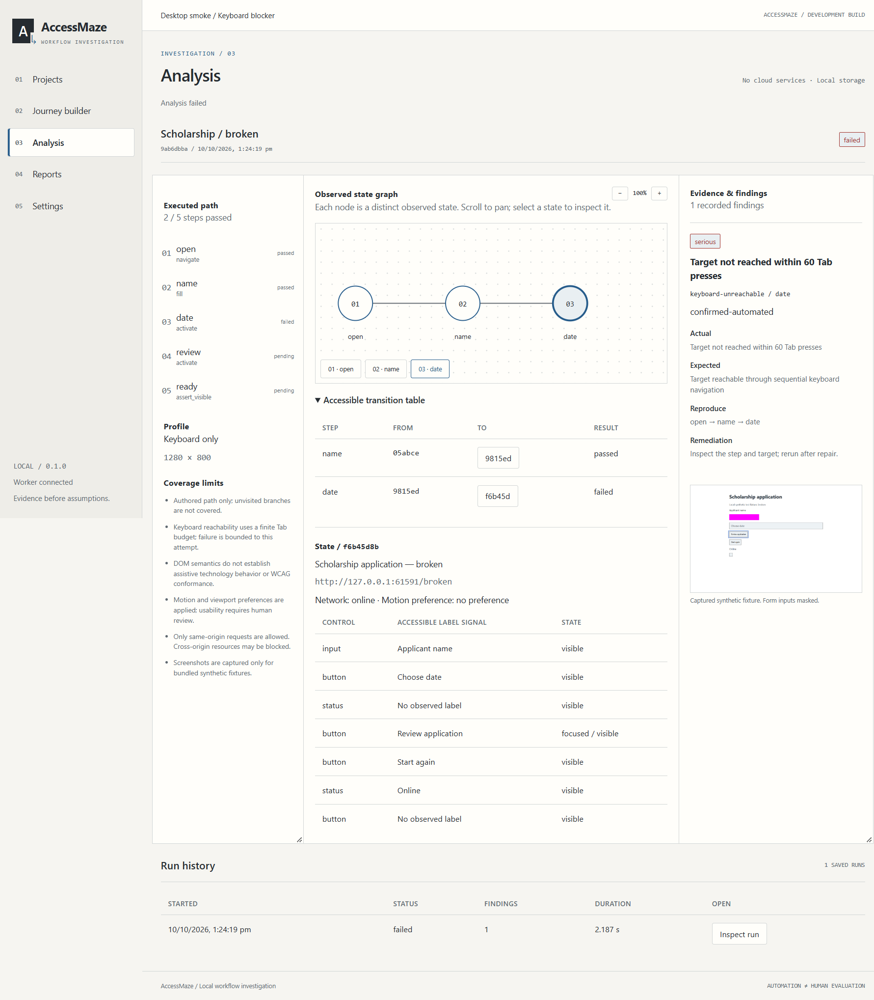
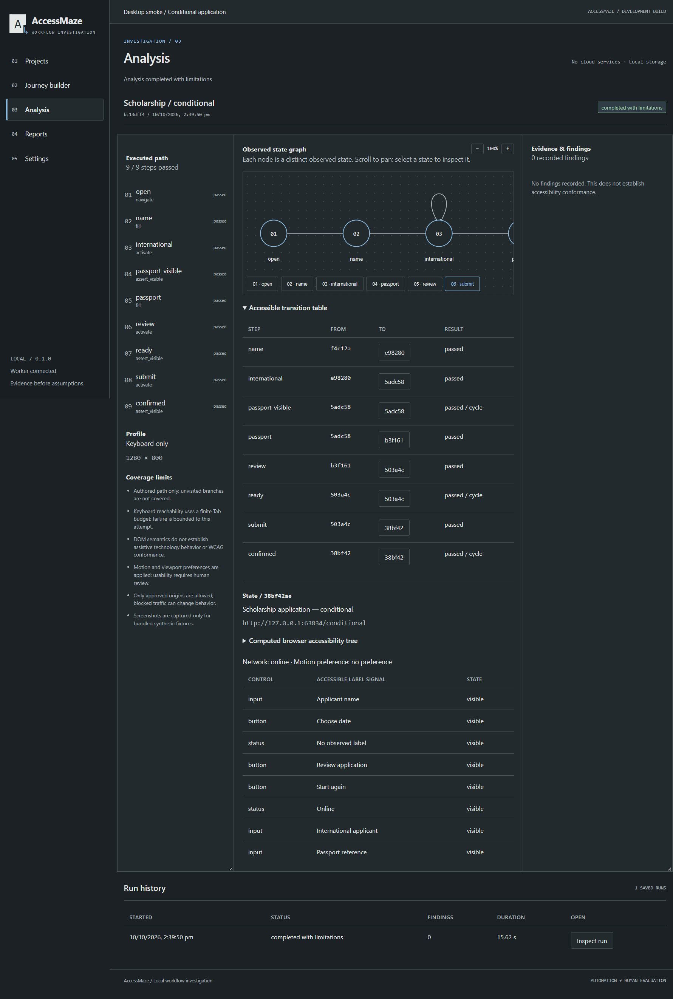

# AccessMaze

AccessMaze runs authored browser journeys under concrete interaction and environment
constraints, and records whether the task reached its completion assertion.
It is a local-first desktop application built with Tauri 2, React, TypeScript,
Python, Playwright and SQLite. No account, cloud analysis or paid service is required.

**Status: development preview.** This repository implements a working vertical slice,
not the full master specification. See [engineering status](docs/development/status.md)
for actual verification and remaining release gates.

## Current functionality

- Saved projects; edit, archive, restore and permanently delete projects and their evidence.
- Semantic journey editor, validated version 1 JSON import/export, mandatory assertions.
- One managed Chromium run at a time; real progress, pause between steps and emergency cancellation.
- Keyboard-only Tab navigation and keyboard activation, or explicitly permitted pointer actions.
- Offline/reconnect transitions, retained-value assertions, request latency, viewport and motion preferences.
- Local axe-core audits, error association/live-region checks and completion assertions.
- Normalized observed-state graph, repeated-state detection, transition table and evidence inspection.
- Opt-in bounded button-branch discovery on resettable synthetic fixtures, including recorded frontier bounds.
- SQLite run history, crash interruption recovery, masked fixture failure screenshots.
- JSON, escaped HTML and formula-safe CSV report exports.
- Persisted retest comparisons, consistent ZIP backups and explicit retention cleanup.
- Synthetic fixtures that demonstrate both successful journeys and observable failures.
- Light/dark desktop UI with labels, focus indicators and keyboard operation.
- Website projects with separate navigation/API and read-only resource permissions,
  DNS pinning, redirect guards and private page-text evidence by default.
- Run-only credential/text bindings and user-selected file uploads; saved definitions
  contain binding names and field labels, never credentials or file paths.

## Limits

Authored paths are bounded by step, Tab and wall-clock budgets. Automatic branch discovery
is limited to named buttons on resettable bundled fixtures; external-site exploration is
not implemented. Graphs show observed states only.
Keyboard findings describe the actual bounded attempt; they cannot establish that every
possible keyboard path is unavailable. DOM semantics and axe-core do not simulate a
screen reader or certify WCAG conformance. Motion preferences and viewport size are
applied settings, not automatic usability verdicts. Latency is request delay, not bandwidth
emulation. Screenshots are enabled only for bundled synthetic fixtures. External targets
use explicitly approved origins. Popups, embedded frames, service workers and WebSockets
are blocked; these restrictions can change application behavior. Blocked traffic makes
findings and repair verification inconclusive.

No real assistive-technology integration, persistent credential management, recording assistant,
PDF export, automatic issue resolution, mobile testing or plugin API is implemented.
Use dedicated test accounts and synthetic input; literal journey inputs are plain text
on disk. Passwords must use run-only bindings. Do not test hostile
websites or production workflows with consequential effects.

## Windows development

Install Git, Node.js 22.12+ (24 recommended), Rust stable with MSVC build tools, WebView2,
and [uv](https://docs.astral.sh/uv/). Python 3.12+ is required; uv can provision it.
Run from the repository root, including when the path contains spaces:

```powershell
npm ci
uv sync --project engine --locked --python 3.13
uv run --project engine playwright install chromium
npm run desktop
```

Choose **Projects → Keyboard blocker**, review the steps, authorize the synthetic
fixture interactions, and run. The date control cannot receive sequential keyboard
focus. Repeat with **Accessible application** to complete the corrected workflow.
**Connection recovery** deliberately clears input after a real offline/online transition.

`npm run dev` opens a UI-only browser preview; analysis requires the desktop host.
The application does not run a separate analysis web server. Its fixture server binds
only to a random loopback port. After dependency and browser installation, fixture
analysis works without internet access.

Windows is the primary target. Python and UI tests can run on Linux; Linux/macOS desktop
packaging has not been verified. Public installers are not yet release-qualified.
See [packaging](docs/releases/packaging.md). To build a portable directory with its
own Python runtime and browser, run:

```powershell
uv run --project engine python scripts/package_windows.py
```

Keep the output directory together and run `AccessMaze.exe` inside it.

## Actual desktop screenshots





## Verification

```powershell
npm run check
npm test
npm run build
npm run format:check
uv run --project engine ruff check engine scripts
uv run --project engine ruff format --check engine scripts
uv run --project engine pytest engine/tests -q
uv run --project engine python scripts/contracts.py --check
cargo check --locked --manifest-path apps/desktop/src-tauri/Cargo.toml
npm audit
uv run --project engine pip-audit
```

Browser tests launch real Chromium against local fixtures. Tests using React components
verify UI behavior separately. Neither is represented as full installed-desktop testing.
See [testing](docs/testing/strategy.md) and [security boundaries](SECURITY.md).

## Architecture

`apps/desktop` contains React and a small Rust host. The host owns a persistent Python
worker and exchanges versioned newline-delimited JSON over private pipes. Python owns
browser contexts, SQLite, graphs and evidence. Analysis runs on a worker thread; commands
remain available for progress and cancellation. Results are saved after every step.
Large screenshots live in per-run artifact directories. The frontend renders persisted
observations rather than synthesizing results.

Contracts live in `packages/contracts`; the Pydantic models generate import and protocol
JSON schemas. Architecture choices and source research are in
[ADR 001](docs/architecture/001-local-worker.md).

## Roadmap and contribution

Next work includes broader branch exploration, stronger network isolation,
recording assistance and upload workflows, full desktop
accessibility evaluation, portable packaging verification and clean-machine installation.
Release gates remain open until tested. Extensibility follows a reliable core.

AccessMaze source uses the MIT license. axe-core is separately licensed MPL-2.0;
see [dependency review](docs/architecture/dependencies.md). No analytics are included.
Read [CONTRIBUTING.md](CONTRIBUTING.md) before submitting changes.
