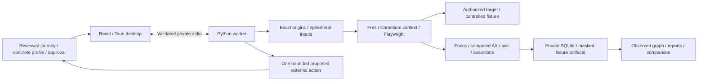

# Local execution architecture

Rust owns the worker and Chromium descendants through a Windows Job object. One run
is active at a time. Fresh browser contexts do not import personal cookies. No target
receives desktop IPC. Origin policy is not an OS firewall or a hostile-target sandbox.

State identity normalizes bounded browser observations, omitting input values and URL
queries. Focus and dynamic labels can split equivalent states; absent application internals
can merge different states. Graphs describe observations, never exhaustive application models.
External discovery never resets or replays effects. Only bundled resettable fixtures permit
branch replay. See ../architecture/001-local-worker.md and 002-authorized-websites.md.
