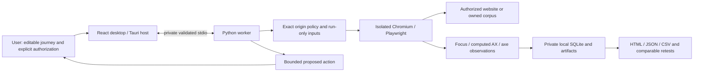

# Hackyard presentation and transparency

AccessMaze tests whether a task can be completed through a real browser journey.
The desktop saves an editable sequence of semantic actions and completion assertions.
A private local worker opens isolated Chromium, observes focus and the browser's
accessibility tree, runs axe rules, and persists evidence and a comparable retest.
Exploration asks for approval before each proposed external action. Runtime bindings
keep credentials and upload bytes out of saved journey definitions.

## Three-minute live sequence

Before presenting, install locked dependencies and browsers, then run
`uv run --project engine python scripts/hackyard_demo.py --output dist/Hackyard-live-new`.
Use a fresh folder every time. Keep the generated artifacts ready if venue connectivity
or screen sharing fails; identify them as a previously executed run, with its timestamp.

1. **0:00–0:30:** Show `journey.json`: named actions, the task's final assertion, bounded
   execution and explicit upload binding. Explain the owned two-origin application.
2. **0:30–1:15:** Show `broken.html` and its observed focus evidence. Continue looks
   actionable but the keyboard cannot reach it. The result comes from Chromium.
3. **1:15–1:45:** Show `correction.diff`: change the role-button div to a native button.
4. **1:45–2:30:** Show `fixed.html`, `retest.json` and the generated summary: the same
   assertion now passes; validation, conditional SPA navigation, modal, offline recovery
   and actual multipart upload reach Application received. Exactly one synthetic POST.
5. **2:30–3:00:** Show `recorded-draft.json` and its successful replay. Input intent is
   recorded as a binding; the entered value is absent. This demonstration drives real
   recording events through a script; do not call it a human NVDA session.

See [the execution procedure](hackyard.md) for ephemeral origins, artifacts and actual
results. Never replace a failed engine run with hardcoded findings or an old success
without identifying its provenance.

## Architecture

The browser is separate from the desktop WebView. The Windows host owns the worker
and descendants through a Job object. Chromium policy is not an OS network firewall.

## Differentiation and boundaries

| Typical page-rule scan                 | AccessMaze's verified additional scope                                         |
| -------------------------------------- | ------------------------------------------------------------------------------ |
| Rule findings on a supplied page state | Authored task transitions and mandatory completion assertions                  |
| DOM/rule observations                  | Native browser AX observations, keyboard reachability and bounded focus traces |
| Independent scan exports               | Journey/project/input-identity checks before a comparable retest               |
| A URL as the primary input             | Reviewable recorded semantic actions and run-only input bindings               |
| Discovery may be an external tool      | Per-action approval for a bounded proposed path                                |

This compares workflows, not every competing product. Existing scanners can support
scripts and integrations; AccessMaze does not claim unique invention of journey testing
or replacement of axe. Axe supplies rule checks here. Keyboard simulation and browser AX
are not actual assistive-technology use, complete visual assessment or WCAG certification.

Current: Windows readiness preview, controlled complex corpus, authorized public smoke
targets, editable recording, run-only uploads, bounded approval, evidence exports and
comparable retests. Limits: no arbitrary exhaustive crawling, no replay/reset of external
effects, limited shadow/virtualized/native-widget observations, Chromium offline emulation
may permit in-flight completion, unsigned packaging, unresolved binary redistribution
obligations. Real NVDA, independent clean-machine/security review and remote CI results
remain unverified. Future work must follow those release gates before broader browser,
platform or assistive-technology support is promised.

## Competition transparency

This is continuation of pre-existing work. The competition's official eligibility/start
date was not provided; the entrant must map this ledger to that date and disclose any
earlier code, tools and team contributions required by the rules.

| Boundary                   | Work to disclose                                                                                                                                                                                                                                                                                                                                                   |
| -------------------------- | ------------------------------------------------------------------------------------------------------------------------------------------------------------------------------------------------------------------------------------------------------------------------------------------------------------------------------------------------------------------ |
| Existing through `275a4e1` | Desktop design and architecture; private worker; SQLite; journey editor; browser execution; axe; focus/AX checks; origin controls; runtime inputs/uploads; recorder; approved exploration; reports/retests; controlled compatibility corpus; broken/fixed Hackyard demo; Windows preview; original readiness documentation and measurements                        |
| Subsequent continuation    | Evidence-based classification of 87 license gaps, notice collector/supplements; explicit-child ACL regression/hardening; diagnostic privacy review; repeated measured stability harness; CI packaging/advisory workflow; this explanation, architecture/differentiation/transparency material. See actual later commits/status for executed versus planned checks. |
| Third-party foundations    | React, Tauri, Python, Playwright/Chromium, axe-core, Pydantic, NetworkX, SQLite and locked transitive dependencies. They are not entrant-authored engines. Notices and obligations are recorded separately.                                                                                                                                                        |

Preserve commit history; use `git log --reverse --oneline` and `git diff 275a4e1..HEAD`
for the precise boundary. This document does not assert eligibility or that pre-existing
features were implemented during the competition.

Current handoff: [submission copy](../hackyard/submission.md),
[ninety-second and five-minute scripts](../hackyard/demo-script.md),
[three technical contribution boundaries](../hackyard/preexisting-work.md),
and [current verification](../development/status.md). The older 275a4e1 ledger above
remains a historical boundary; it does not replace later c634573 continuation evidence.
The current paired corpus actually executes axe and Pa11y, with explicit differing
workloads; earlier feature comparisons are not a general competitive benchmark.
